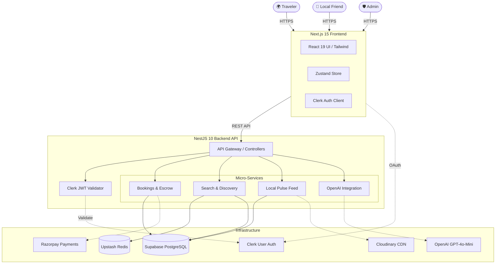

<div align="center">
  
  <h1>🌍 MebingLocal</h1>
  <p><b>Connect with verified Local Friends for authentic, personalized city experiences.</b></p>

  <!-- Badges -->
  <a href="https://nextjs.org/"></a>
  <a href="https://nestjs.com/"></a>
  <a href="https://www.postgresql.org/"></a>
  <a href="https://openai.com/"></a>
  <a href="https://clerk.com/"></a>
</div>

<br/>

## 📖 Overview

**MebingLocal** is a modern, full-stack marketplace platform designed to bridge the gap between travelers and authentic local experiences. Unlike traditional static tour bookings, MebingLocal allows travelers to discover, chat with, and book verified **Local Friends** by the hour. 

With a built-in **AI Intelligence Layer**, travelers receive hyper-personalized itinerary recommendations, dynamic language translation, and automated safety monitoring.

---

## ✨ Key Features

- 🔍 **Dynamic Discovery**: Search Local Friends by location, hourly rate, verified status, languages, and specific interests.
- 💬 **AI-Powered Chat**: An intelligent travel assistant that helps you plan your trip, translate languages, and match you with the perfect companion.
- 💳 **Secure Payments**: Integrated with Razorpay for secure escrow-style booking holds, including an automated commission split.
- 🛡️ **Women-Only Mode**: A dedicated, verified safe space for female travelers to find female local companions.
- 📱 **Local Pulse Feed**: A dynamic feed (similar to Instagram/TikTok) where Local Friends can post real-time updates of hidden gems in their city.
- 👮 **Admin Dashboard**: Dedicated portal for platform administrators to review reports, manage users, and monitor analytics.

---

## 🏗️ Architecture & System Design

MebingLocal utilizes a decoupled **Client-Server Architecture** communicating over REST APIs. The frontend is heavily optimized with Server-Side Rendering (SSR) via Next.js, while the backend relies on Fastify's raw performance combined with NestJS's robust dependency injection.



---

## 💻 Tech Stack

### Frontend
- **Framework**: [Next.js 15](https://nextjs.org/) (App Router)
- **UI Library**: [React 19](https://react.dev/)
- **Styling**: [Tailwind CSS](https://tailwindcss.com/) + [shadcn/ui](https://ui.shadcn.com/)
- **State Management**: [Zustand](https://zustand-demo.pmnd.rs/)
- **Icons**: [Lucide React](https://lucide.dev/)
- **Data Fetching**: Native `fetch` with custom hooks

### Backend
- **Framework**: [NestJS 10](https://nestjs.com/)
- **Engine**: [Fastify](https://fastify.dev/) (For extreme I/O performance)
- **ORM**: [Prisma](https://www.prisma.io/)
- **Security**: `@fastify/helmet`, `@nestjs/throttler` (Rate Limiting)
- **Validation**: `class-validator`, `class-transformer`

### Infrastructure & SaaS
- **Database**: [Supabase](https://supabase.com/) (PostgreSQL)
- **Caching**: [Upstash Redis](https://upstash.com/)
- **Authentication**: [Clerk](https://clerk.com/)
- **Payments**: [Razorpay](https://razorpay.com/)
- **AI**: [OpenAI](https://openai.com/) API (GPT-4o-mini model)
- **Media**: [Cloudinary](https://cloudinary.com/)

---

## 🚀 Getting Started

### Prerequisites
- Node.js (v20+ recommended)
- `npm` or `pnpm`
- A PostgreSQL database (e.g., Supabase)

### 1. Clone the repository
```bash
git clone https://github.com/yourusername/mebinglocal.git
cd mebinglocal
```

### 2. Backend Setup
```bash
cd backend
npm install

# Copy environment variables and fill them in
cp .env.example .env

# Generate Prisma Client & Push Schema
npx prisma generate
npx prisma db push

# Start the development server
npm run start:dev
```
The backend API will run at `http://localhost:3001/api/v1`

### 3. Frontend Setup
```bash
cd frontend
npm install

# Copy environment variables and fill them in
cp .env.example .env.local

# Start the development server
npm run dev
```
The frontend will run at `http://localhost:3000`

---

## 🔐 Security & Hardening (Phase 6)
MebingLocal is built with production-grade security standards:
- **Strict CORS & Helmet**: Fastify Helmet protects against XSS, while CORS strictly limits cross-origin API access.
- **Race Condition Prevention**: Prisma `Serializable` transactions ensure absolute consistency during Booking slot claims.
- **Granular Rate Limiting**: AI and Auth endpoints have dedicated request throttling to prevent API abuse and control OpenAI token costs.
- **Robust IDOR Checks**: Every controller strictly validates resource ownership (e.g., travelers can only modify their *own* bookings).

---

## 🧪 Testing

The repository supports both backend unit testing and frontend end-to-end testing.

**Backend (Jest):**
```bash
cd backend
npm run test
```

**Frontend E2E (Playwright):**
```bash
cd frontend
npm run test:e2e
```

---

<div align="center">
  <p>Built with ❤️ by the MebingLocal Engineering Team.</p>
</div>